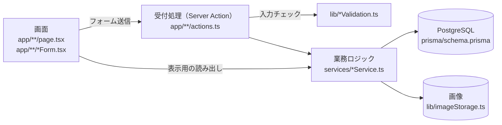
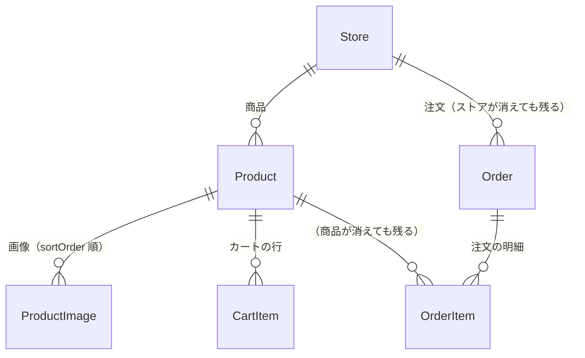
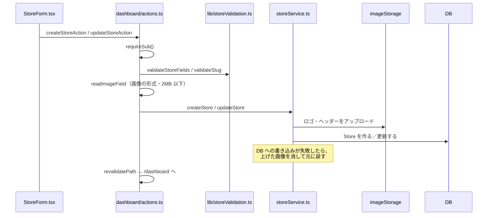
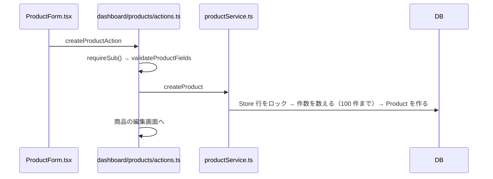
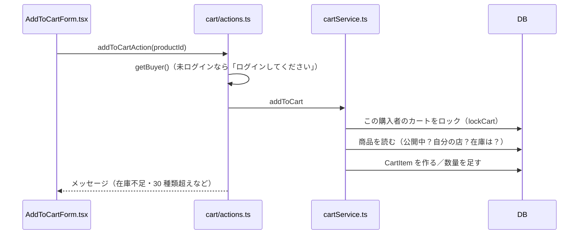
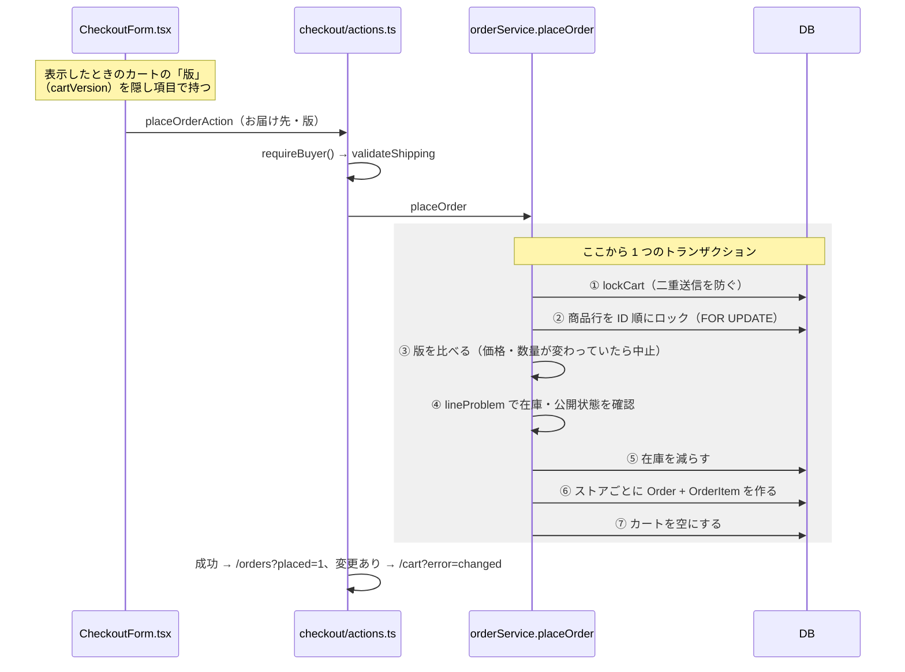
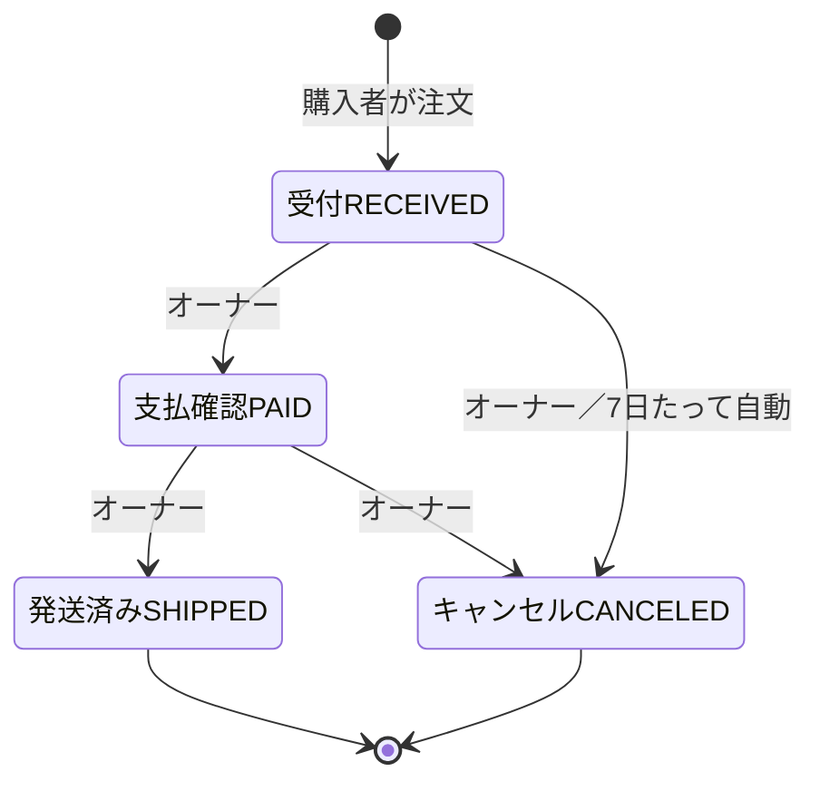
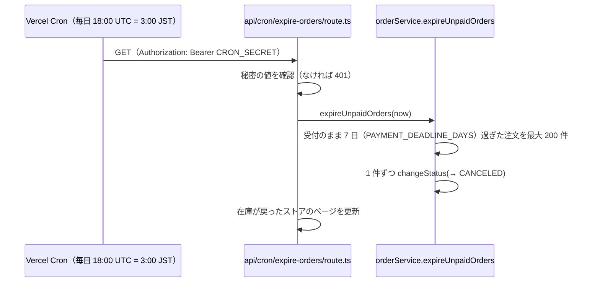

# 機能ガイド

このガイドは「どんな機能があるか」「その機能はどのファイルで動いているか」「機能を足すときにどこを直すか」をまとめたものです。

1. [機能一覧](#1-機能一覧) — 何があって、何がないか
2. [処理の流れ](#2-処理の流れ) — 機能ごとに、画面からデータベースまで何が起きるか
3. [機能を足すときの手順](#3-機能を足すときの手順) — よくある変更で触るファイルの順番

最後に、このガイドを書いていて分かりにくかった所を[付録](#付録-分かりにくい所リファクタリング候補)にまとめています。

---

## 1. 機能一覧

### ✅ あるもの

#### 誰でも（ログインなし）

| 機能 | 画面 | 中心になるファイル |
|---|---|---|
| ストア一覧（トップページ。24 件ずつ、新しい順） | `/stores`（`/` はここへ転送） | `app/stores/page.tsx` → `listPublishedStores`（`services/storeService.ts`） |
| ストアのページ（ロゴ・ヘッダー・商品一覧） | `/s/<ストアID>` | `app/s/[slug]/page.tsx` → `getStoreForViewer` / `listProductsForStorePage` |
| 商品の詳細（画像・価格・在庫・売り切れ表示） | `/s/<ストアID>/products/<商品ID>` | `app/s/[slug]/products/[productId]/page.tsx` → `getProductForViewer`（`services/productService.ts`） |

非公開のストアや商品は 404 になります。ただしオーナー本人が見ると「プレビュー」として表示されます。

#### ストアのオーナー（出品者）

| 機能 | 画面 | 中心になるファイル |
|---|---|---|
| ストアを作る（1 人 1 店まで） | `/dashboard`（まだストアがないときは作成フォームになる） | `app/dashboard/actions.ts` の `createStoreAction` → `createStore` |
| ストアを編集する（名前・説明・テーマカラー・ロゴ・ヘッダー・お支払い方法の案内・連絡先メール） | `/dashboard` | `updateStoreAction` → `updateStore` |
| ストアを公開／非公開にする | `/dashboard` | `setPublishedAction` → `setPublished` |
| ストアを削除する（ストア ID の入力で確認。対応中の注文があると削除できない） | `/dashboard` | `deleteStoreAction` → `deleteStore` |
| 商品を登録・編集・削除する（1 店 100 件まで） | `/dashboard/products` | `app/dashboard/products/actions.ts` → `services/productService.ts` |
| 商品画像を追加・削除・並べ替える（1 商品 5 枚まで。先頭がサムネイル） | `/dashboard/products/<商品ID>` | `addProductImageAction` / `removeProductImageAction` / `makeProductImageFirstAction` |
| 商品を公開／非公開にする | `/dashboard/products/<商品ID>` | `setProductPublishedAction` → `setProductPublished` |
| 注文を見る（状態で絞り込み） | `/dashboard/orders` | `listStoreOrders`（`services/orderService.ts`） |
| 注文の状態を変える（受付 → 支払確認 → 発送済み。途中ならキャンセル可） | `/dashboard/orders/<注文ID>` | `app/dashboard/orders/actions.ts` → `changeOrderStatusAsOwner` |

#### 購入者（ログインあり）

| 機能 | 画面 | 中心になるファイル |
|---|---|---|
| カートに入れる（1 商品 10 個まで・30 種類まで・在庫の数まで。自分のストアの商品は不可） | 商品の詳細ページ | `app/cart/actions.ts` の `addToCartAction` → `addToCart`（`services/cartService.ts`） |
| カートの数量を変える・削除する | `/cart` | `setCartQuantityAction` / `removeFromCartAction` |
| 注文する（お届け先を入力。ストアごとに注文が分かれる） | `/checkout` | `app/checkout/actions.ts` の `placeOrderAction` → `placeOrder` |
| 注文履歴と詳細を見る（支払い方法の案内・お支払い期限・ストアの連絡先） | `/orders`、`/orders/<注文ID>` | `listBuyerOrders` / `getBuyerOrder` |

#### 自動で動くもの

| 機能 | いつ | 中心になるファイル |
|---|---|---|
| 受付のまま 7 日たった注文を自動キャンセルし、在庫を戻す | 毎日 日本時間 3 時（`vercel.json` の Cron） | `app/api/cron/expire-orders/route.ts` → `expireUnpaidOrders` |

### 🚧 画面だけあるもの

| 機能 | 画面 | 状態 |
|---|---|---|
| 新着商品 | `/new` | 「準備中です」と表示されるだけ（ユーザーメニューからリンクあり） |
| フォロー | `/following` | 「準備中です」と表示されるだけ。データベースにも何もない |

### ❌ ないもの

| 機能 | 補足 |
|---|---|
| サイト内での決済 | 支払いはストアが案内する方法で、サイトの外で行う |
| メール通知 | 注文時・発送時などに何も送らない |
| 送料の計算 | 注文の合計は商品代だけ |
| 検索・カテゴリ | ストア一覧は新しい順に並ぶだけ |
| レビュー・クーポン | — |
| 購入者による注文キャンセル | わざと入れていない仕様。キャンセルできるのはオーナーと自動キャンセルだけ |
| 1 人で複数のストアを持つこと | `Store.ownerSub` が `@unique` |
| ストアの売上集計 | 注文管理の画面に状態ごとの注文件数が出るだけ |

---

## 2. 処理の流れ

### 2-0. 全体の形

どの機能も、ほぼ同じ 4 段で動いています。



| 段 | 役割 | ルール |
|---|---|---|
| 画面（`page.tsx`） | データを読んで表示する | 読み出しも services の関数を呼ぶ |
| 受付処理（`actions.ts`、`"use server"`） | ログイン確認 → 入力チェック → services を呼ぶ → 画面のキャッシュを更新（`revalidatePath`）→ 移動（`redirect`） | エラーメッセージの文言はここで決める |
| 業務ロジック（`services/`） | データベースの読み書き。在庫・権限・同時実行の正しさはここで守る | 結果を `{ ok: true }` か `{ ok: false, code: "..." }` で返す（例外にしない） |
| 小さな関数（`lib/`） | 入力チェック、表示用の整形、上限値の定数 | データベースに触らない。ユニットテストあり |

**services への渡し物**: services の関数は最初の引数に `deps`（`{ db, storage }`）を受け取ります。型は `services/deps.ts` の `StoreDeps` です。本番では同じファイルの `deps()` が Prisma と Supabase を渡し、テストではメモリの画像置き場に差し替えます。画面と受付処理は `import { deps } from "@/services/deps"` で受け取ります。

**全体で使う小さな部品**:

| 部品 | 場所 | 用途 |
|---|---|---|
| `isUuid` | `lib/uuid.ts` | URL やフォームから来た ID が UUID の形か確かめる |
| `text(formData, name)` | `lib/formData.ts` | フォームの文字列の値を取り出す（ないときは空文字） |
| `SAVE_FAILED` | `lib/formData.ts` | 保存が例外で失敗したときの共通の文言 |

**ログインの確かめ方**（`lib/session.ts`）:

| 関数 | 使う場面 | ログインしていないとき |
|---|---|---|
| `getSub()` / `getBuyer()` | ログインしていなくても見られる画面 | `null` を返す |
| `requireSub()` | オーナーの画面・処理 | ログイン画面へ送り、終わったら `/dashboard` に戻す |
| `requireBuyer(戻り先)` | 購入者の画面・処理 | ログイン画面へ送り、終わったら指定の画面に戻す |

ユーザーは Candy Rain ID の `sub`（ユーザーごとの固定の ID）で見分けます。データベースにユーザーの表はなく、`Store.ownerSub` や `Order.buyerSub` にこの値が入ります。

### 2-1. データのつながり



- **ストアや商品を消すと**、その商品の画像とカートの行も一緒に消えます。注文と明細は残り、ストアや商品へのつながりだけが切れます（`onDelete: SetNull`）。
- **注文には、注文した時点の値をコピーして持たせています**（`storeName`、`paymentInstructions`、`productName`、`unitPrice`）。あとで商品の価格やストア名が変わっても、注文履歴は変わりません。

### 2-2. ストアを作る・編集する



- ストア ID（slug）はほかの人と重複できません。重複するとデータベースのエラー（`P2002`）になり、「このストア ID はすでに使われています」と表示されます。
- 削除（`deleteStore`）は、受付中か支払確認済みの注文が 1 件でもあると断ります。

### 2-3. 商品を登録する



- 商品は**非公開**で作られます。ストアページに出すには、編集画面で公開します。
- **在庫の編集には注意が必要です。** 注文やキャンセルで在庫は勝手に増減します。そのため `updateProduct` は、編集画面を開いたときの在庫数（`stockBase`）とデータベースの在庫が同じときだけ在庫を書き換えます。違っていれば「在庫が注文で変わりました」と表示されます。

### 2-4. カートに入れる



**カートを触る処理はすべて `lockCart` を通ります。** ロックは購入者ごとに 1 つで、追加・数量変更・削除・注文確定が同時に走っても順番に処理されます（PostgreSQL の advisory lock を使用）。

カートを表示するとき（`getCart`）は、行ごとに `lineProblem` で「買えない理由」を調べます。理由は「非公開になった」「在庫が足りない」「自分の店」のいずれかです。理由がある行が 1 つでもあると、注文に進めません。

### 2-5. 注文する（いちばん大事な処理）



- ① と ② のロックで、同じ商品の最後の 1 個を 2 人が同時に注文しても、在庫がマイナスになりません。
- ③ の「版」は、カートの行・数量・単価から作ったハッシュ値です。注文手続き画面を開いたあとにオーナーが値上げした場合などは、確定せずにカートへ戻します。
- 1 つのストアへの注文の合計には上限があります（約 21 億円。データベースの整数型の上限）。

### 2-6. 注文の状態が変わる



- どこからどこへ進めるかは `lib/orderStatus.ts` の `OWNER_TRANSITIONS` が決めています。状態を変えるのはオーナーだけです。
- 実際に状態を書き換えるのは `orderService.ts` の `changeStatus` です。オーナーの操作（`changeOrderStatusAsOwner`）も自動キャンセル（`expireUnpaidOrders`）も、この同じ関数を通ります。
  - 読んだときの状態のままのときだけ書き換えるので、オーナーの操作と自動キャンセルが同時に起きても二重に処理されません。
  - キャンセルになったときは在庫を戻します。

### 2-7. 自動キャンセル



---

## 3. 機能を足すときの手順

### 3-1. ストア（または商品）に項目を足す

実例: 「ストアの連絡先メール」（コミット `0214d2f`）

| 順 | ファイル | やること |
|---|---|---|
| 1 | `prisma/schema.prisma` | `Store` にフィールドを足す |
| 2 | `prisma/migrations/<日時>_<名前>/migration.sql` | `npx prisma migrate dev --name <名前>` で作る |
| 3 | `lib/storeValidation.ts`（商品なら `productValidation.ts`） | `StoreField` 型・`StoreFields` 型・`validateStoreFields` にチェックを足す |
| 4 | `lib/storeValidation.test.mts` | チェックのテストを足す |
| 5 | `app/dashboard/actions.ts` | `StoreFormState.values` と `parseStoreForm` にフォームの値を足す |
| 6 | `app/dashboard/StoreForm.tsx` | 入力欄を足す |
| 7 | 表示する画面（例: `app/s/[slug]/page.tsx`、`app/orders/[orderId]/page.tsx`） | 表示する |
| 8 | `tests/integration/storeService.test.mts` | 保存できることのテストを足す |
| 9 | `README.md` | 機能の説明を更新する |

`services/storeService.ts` は `...input.fields` で項目をまとめて保存するので、たいていは**手を入れなくて済みます**。

**注文にも残したい値**の場合（「お支払い方法の案内」のように、注文した時点の値を保存しておきたいとき）は、次の 2 つも必要です。
- `Order` にも列を足す
- `orderService.ts` の `placeOrder` で `order.create` にコピーを足す

### 3-2. 新しい画面を足す

| 順 | ファイル | やること |
|---|---|---|
| 1 | `app/<パス>/page.tsx` | 画面を作る。ログインが必要なら最初に `requireSub()` か `requireBuyer("<パス>")` を呼ぶ |
| 2 | `services/*Service.ts` | 必要なデータを読む関数を足す（画面から直接 `prisma` を使わない） |
| 3 | `app/<パス>/loading.tsx` | 読み込み中の表示（ほかの画面に合わせるなら） |
| 4 | `app/components/SiteHeader.tsx` か `app/dashboard/DashboardNav.tsx` | メニューにリンクを足す |
| 5 | `e2e/*.spec.ts` | 必要なら画面の通しテストを足す |

### 3-3. 新しい操作（ボタン・フォーム）を足す

| 順 | ファイル | やること |
|---|---|---|
| 1 | `services/*Service.ts` | 処理を書く。結果は `{ ok: true }` / `{ ok: false, code: "..." }` で返す。**権限の確認（自分のストアか、など）はここでする** |
| 2 | `tests/integration/*Service.test.mts` | テストを書く（実際の DB を使う） |
| 3 | `app/<パス>/actions.ts` | `"use server"` の関数を足す。ログイン確認 → 入力チェック → service → `revalidatePath`。フォームの値は `lib/formData.ts` の `text`、失敗時の文言は `SAVE_FAILED` を使う。`prisma` は直接使わない |
| 4 | 画面のコンポーネント | フォームから呼ぶ（`useActionState` でメッセージを受け取る） |

在庫やカートに触る場合は、既存のロックの順番に合わせてください。
- カートなら、最初に `lockCart` を呼びます。
- 商品なら、ID 順に `FOR UPDATE` でロックします。

順番がずれると、同時に動いたときに止まる（デッドロックする）おそれがあります。

### 3-4. 注文の状態を足す

| 順 | ファイル | やること |
|---|---|---|
| 1 | `prisma/schema.prisma` の `enum OrderStatus` + マイグレーション | 状態を足す |
| 2 | `lib/orderStatus.ts` | `OrderStatus` 型、`ORDER_STATUSES`、`ORDER_STATUS_LABELS`、`OWNER_TRANSITIONS` を更新 |
| 3 | `lib/orderStatus.test.mts` | 進める先のテストを更新 |
| 4 | `app/components/OrderStatusBadge.tsx` | バッジの色を決める |
| 5 | `services/orderService.ts` | 在庫を戻すべき状態なら `changeStatus` を確認。`deleteStore` の「対応中の注文」の条件も確認 |

### 3-5. 上限値を変える

| 上限 | 場所 |
|---|---|
| 1 店の商品数（100）・1 商品の画像数（5）・価格・在庫の上限 | `lib/productValidation.ts` |
| 1 商品の数量（10）・カートの種類数（30） | `lib/orderValidation.ts` |
| 画像のサイズ（2MB） | `lib/storeValidation.ts` の `MAX_IMAGE_BYTES`（画面側は `next.config.ts` の `bodySizeLimit: 5mb` も関係） |
| 支払期限（7 日） | `lib/orderStatus.ts` の `PAYMENT_DEADLINE_DAYS` |
| ストア一覧の 1 ページの件数（24） | `app/stores/page.tsx` の `PAGE_SIZE` |

### 3-6. 変更したら確かめること

```bash
npm test                  # lib のユニットテスト
npm run lint
npm run typecheck
npm run test:integration  # services の結合テスト（ローカルの DB が必要）
```

---

## 付録: 分かりにくい所（リファクタリング候補）

このガイドを書いていて説明しづらかった所です。

**対応済み（2026-11-16）**: `deps()` と `StoreDeps` 型を `services/deps.ts` へ、`isUuid` を `lib/uuid.ts` へ、`text` と `SAVE_FAILED` を `lib/formData.ts` へ移し、ストア削除の受付処理から `prisma` の直接利用をなくしました（設計は `docs/superpowers/specs/2026-11-16-module-placement-design.md`）。

**見送ったもの**:

| 箇所 | 分かりにくさ | 見送った理由 |
|---|---|---|
| `app/orders/[orderId]/page.tsx` と `app/dashboard/orders/[orderId]/page.tsx` | 購入者用とオーナー用の注文詳細が並んでいる | 共通なのは「注文内容」「お届け先」のカードだけで、レイアウトも中身も違う。まとめると分岐が増えて読みにくくなる |
